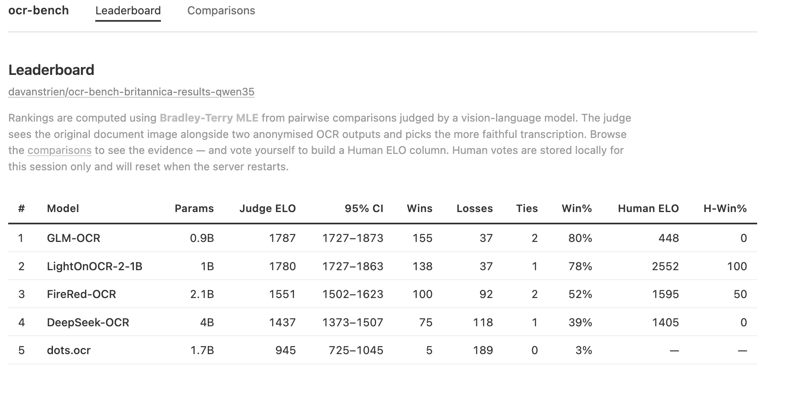

# ocr-bench

**The best OCR model can depend on your documents.** Manuscript cards, printed books and historical texts can favour different models, so ocr-bench measures each collection separately.

`ocr-bench` allows you to create **per-collection leaderboards** using a VLM-as-judge approach, so you can find what works best for _your_ documents rather than relying on generic benchmarks. You can validate the VLM's judgement with human votes, and share results via the Hugging Face Hub.

The underlying OCR model inference uv scripts are available at [uv-scripts/ocr](https://huggingface.co/datasets/uv-scripts/ocr). The majority of these use vLLM for efficient GPU inference, and are designed to run on a single consumer GPU (e.g. 24GB 3090/4090). The `ocr-bench` package orchestrates running these models at scale on the Hub, and judging outputs with a VLM. If you just want to run some OCR models on your data without the judging/leaderboard aspect, you can run the scripts directly.

## Why?

Generic OCR benchmarks tell you which model wins _on average_. But if you're digitising 18th-century encyclopaedias, that average doesn't help — the best model for your documents might be the worst on someone else's. Inspired by [Datalab's Benchmarks + Evals](https://www.datalab.to/blog/datalab-benchmarks-evals) approach — pairwise VLM-as-judge with Bradley-Terry scoring on your own documents — ocr-bench brings this idea to the Hugging Face Hub as an open-source, self-serve tool.

ocr-bench lets you run the same set of OCR models on a sample of _your_ collection, then uses a vision-language model to judge which produces the best transcription for each document. The result is a leaderboard specific to your data.

The two published example boards, as ELO with page-level bootstrap 95% confidence intervals. Models whose intervals overlap are not separated by the run:

| Model              | Britannica 1771 (50 pages)  | BPL card catalog (33 judged cards of 50) |
| ------------------ | :-------------------------: | :--------------------------------------: |
| NuExtract3 (4B)    | 1734 (1669–1820)            | —                                        |
| GLM-OCR (0.9B)     | 1588 (1523–1655)            | 1434 (1361–1509)                         |
| LightOnOCR-2 (1B)  | 1588 (1552–1623)            | 1526 (1449–1611)                         |
| FireRed-OCR (2.1B) | 1426 (1358–1489)            | —                                        |
| dots.ocr (1.7B)    | 1409 (1345–1469)\*          | 1632 (1571–1702)                         |
| DeepSeek-OCR (4B)  | 1255 (1190–1309)            | 1408 (1336–1474)                         |

On Britannica, NuExtract3 is ahead of every other model. Below it, GLM-OCR and LightOnOCR-2 overlap each other and are ahead of the rest. FireRed-OCR and dots.ocr overlap each other and are ahead of DeepSeek-OCR. On BPL, dots.ocr is ahead of GLM-OCR and DeepSeek-OCR, and LightOnOCR-2 overlaps all three. So dots.ocr is in the lower half on Britannica and has the highest rating on BPL, where only LightOnOCR-2 overlaps it. Two collections cannot show which model suits which document type, but they show that the order can change. For your own boards, judging more pages gathers more evidence, and human votes in the viewer cross-check the judge on the overlapping pairs; neither guarantees separation.

Both boards were judged with ocr-bench 0.0.5, the default judge and criteria, and `--max-ocr-text-len 8000`, because most Britannica pages are longer than the 2,500-character default. 21 of the 300 Britannica outputs are still longer than 8,000 characters; 20 of them are repetition loops, and the judge sees their first 8,000 characters. On BPL, 17 of the 50 cards had no output of 20 or more characters from any model, and the source dataset has no text for them, so they look blank. They were not judged.

\* From a re-run of dots.ocr. Its first Britannica run produced only `[OCR ERROR]` placeholders; current versions exclude such outputs and mark the run as failed.

**[Try the live viewer](https://huggingface.co/spaces/davanstrien/ocr-bench-britannica-results-qwen35-viewer)** — a demo on an earlier Britannica 1771 board. It uses the previous default judge and more models, so its rankings and votes cover different comparisons from the tables above, and its dots.ocr row is the failed run. Compare OCR outputs side-by-side and vote on quality yourself.

## Hub-native by design

The entire evaluation loop lives on the Hugging Face Hub:

1. **Your dataset** on the Hub (images + optional ground truth)
2. **OCR models** run via [HF Jobs](https://huggingface.co/docs/hub/jobs-overview) → outputs written as PRs on a Hub dataset
3. **VLM judge** via [HF Inference Providers](https://huggingface.co/docs/inference-providers/index) — only needs an HF token
4. **Results** published to a Hub dataset (leaderboard + pairwise comparisons)
5. **Viewer** as a [HF Space](https://huggingface.co/spaces) for browsing and human validation

No local GPU required. Everything is shareable via Hub URLs.

OCR outputs and results contain text from your pages, so they follow the source's visibility. When the source dataset is private or gated, `run`, `judge` and `bench` create the output and results repos as private, and stop before writing anything if one already exists as a public repo. Pass `--private` to require private repos for a public source too, or `--public` to allow public repos for a private source. An existing repo's visibility is never changed. A viewer Space for private results is created private, and needs an `HF_TOKEN` secret with read access to the results.

## Quickstart

```bash
uv pip install ocr-bench[viewer]

# 1. Run OCR models on your dataset
ocr-bench run <input-dataset> <output-repo> --max-samples 50

# 2. Check the outputs before the paid judge run (free, read-only)
ocr-bench audit <output-repo> --screen

# 3. Judge outputs pairwise with a VLM
ocr-bench judge <output-repo>

# 4. Browse results + validate
ocr-bench view <output-repo>-results
```

### One command

Or chain all three stages in a single call — the fastest way to try ocr-bench on a new collection:

```bash
ocr-bench bench <input-dataset> <output-repo> --max-samples 50
```

`bench` runs the models (waiting for the jobs to finish), judges the outputs, then opens the viewer. It threads the shared flags through each stage: `--models`, `--judge-model` (repeatable for a jury), `--max-samples`, `--seed`, `--adaptive-strategy`, `--size-tie-ratio`, `--no-publish`, and `--port`/`--host` for the viewer. Reach for the individual subcommands when you want finer control over a single stage.

## How it works

**`ocr-bench run`** launches OCR models on your dataset via [HF Jobs](https://huggingface.co/docs/hub/jobs-overview). Each model writes its output as a PR on the same Hub dataset, keeping everything together without merge conflicts.

**`ocr-bench audit`** is a free, read-only check to run before you pay for judge calls. It finds the same configs as `judge` (`--configs`, `--columns` and `--from-prs` work as there). For each model, it reports empty outputs, error placeholders, output length, and how many outputs the judge's text cap (`--max-ocr-text-len`) would truncate. It exits with code 1 if the outputs would break a judge run.

With `--screen` and 3 or more models, `audit` also compares each model's output with the other models' outputs on the same page. It counts repetition loops and counting loops (`- 1`, `- 2`, `- 3`, …), outputs more than 5× the others' length, text on pages that most models leave blank, and empty output on pages where most models have text. It gives each model a peer-agreement score, and suggests a text cap that fits every output that no check flagged. The screen can show weak models before the judge run. Its findings are leads, not verdicts: one model can be right where the others are wrong, and peer agreement is not a ranking. For example, a real list of 50 or more numbered entries with the same text in each (`1 Ditto`, `2 Ditto`, …) also counts as a counting loop; `--json` lists those rows under `loop.counting_rows`. `--json` prints the report for scripts and agents, with the thresholds and the flagged rows.

**`ocr-bench judge`** runs pairwise comparisons using a VLM judge (default: [Qwen3.8-27B](https://huggingface.co/Qwen/Qwen3.8-27B) on Novita via HF Inference Providers; pass `--model` to choose another). The default is pinned to one provider because the same model can behave differently across providers. Boards judged with an earlier default resume only with that judge passed explicitly; the error message names it. For each document, the judge sees the original image and two OCR outputs (anonymised as A/B) and picks the better transcription. Results are fit to a [Bradley-Terry model](https://en.wikipedia.org/wiki/Bradley%E2%80%93Terry_model) to produce ELO ratings with page-level bootstrap 95% confidence intervals. Adaptive stopping halts early when rankings are statistically resolved.

The historical `balanced` adaptive strategy judges every model pair in each five-page batch. Large model grids can opt into targeted allocation once the run has enough balanced evidence to compute an initial board:

```bash
ocr-bench judge <output-repo> \
  --adaptive-strategy targeted \
  --size-tie-ratio 3
```

`targeted` tops up only adjacent pairs whose confidence intervals remain unresolved. The optional size rule applies to **either** adaptive strategy: it can satisfy the whole-run stopping condition in `balanced` mode, while `targeted` also stops topping up that pair. It activates once the pair has at least 10 direct comparisons and one model has at least 3× fewer parameters. The leaderboard marks the smaller model as a practical deployment preference; this does **not** alter ELO/rank or claim the models are statistically equivalent. Unknown/custom model sizes simply remain unresolved. Both settings are recorded in results metadata.

Targeted allocation is experimental and remains opt-in because it conditions later sampling on interim rankings; ordinary bootstrap CIs do not fully account for that optional stopping and may be somewhat optimistic. The default remains `balanced` while targeted allocation is validated.

To avoid wasting judge calls on uninformative pairs, the judge skips comparisons where **both** outputs are shorter than `--min-chars` (default 20 — neither model produced meaningful text), and scores **identical** outputs as an automatic tie without calling the judge. Pass `--min-chars 0` to disable the length filter.

The leaderboard's **Pages** column shows on how many pages each model is ranked: N of the M pages in the judged sample (`--max-samples`, or every row). N counts the pages where the model took part in at least one judged or auto-tied comparison, and its rating uses only those pages. Error sentinels (placeholders such as `[OCR ERROR]`) are excluded from judging, so a model with some of them is ranked on fewer pages. `judge` prints a note when a model has any, and a warning above 10%. The results card repeats the numbers in a Coverage section, and the `metadata` config stores them as `model_coverage`.

Before judging, `judge` and `bench` warn when `--max-ocr-text-len` truncates more than half of the outputs in the sample, overall or for one model. The warning suggests a cap that fits every output that the `audit --screen` checks do not flag. The run keeps the cap that you set.

> [!IMPORTANT]
> Results written before per-comparison resume provenance require a one-time
> `--full-rejudge` or a new results repository. Older versions could pair the
> latest model identity with an earlier OCR text column when configs contained
> appended `inference_info` entries; legacy skip data cannot establish which
> inputs produced a verdict.
>
> New comparisons and checkpoints record a fingerprint of the selected source
> rows/images, OCR contents, resolved model and original output column, judge
> configuration, and text/image preprocessing settings. Resuming with changed
> inputs stops before reusing verdicts and requires `--full-rejudge` or a new
> results repository. Unchanged pairs can still resume when adding a new model,
> including after an interrupted run that published only a comparisons checkpoint.

**`ocr-bench view`** serves a local web viewer with a leaderboard, comparison browser, and human validation. Vote on comparisons to cross-check the automated judge with human judgement.

## Available models

ocr-bench ships with 16 registered OCR models. Five form the default set:

| Model           | Size | Hub model                     |
| --------------- | ---- | ----------------------------- |
| `glm-ocr`       | 0.9B | `zai-org/GLM-OCR`             |
| `lighton-ocr-2` | 1B   | `lightonai/LightOnOCR-2-1B`   |
| `firered-ocr`   | 2.1B | `FireRedTeam/FireRed-OCR`     |
| `deepseek-ocr`  | 4B   | `deepseek-ai/DeepSeek-OCR`    |
| `dots-ocr`      | 1.7B | `rednote-hilab/dots.ocr`      |

The two example boards above put the models in different orders, so run the set on a sample of your own pages.

The opt-in registry also includes compact models at different quality/cost points, including `falcon-ocr` (0.3B) and `ovis-ocr2` (0.9B). List every available model with:

```bash
ocr-bench run --list-models
```

All model scripts are available at [uv-scripts/ocr](https://huggingface.co/datasets/uv-scripts/ocr) on the Hub.

By default all 5 models in the table run. To pick specific models:

```bash
ocr-bench run <dataset> <output> --models tesseract falcon-ocr ovis-ocr2
```

## Example results



The screenshot shows the viewer layout from an earlier Britannica run. Its numbers are out of date, and its dots.ocr row came from failed OCR outputs.

Browse these on the Hub:

- [davanstrien/ocr-bench-britannica-results-qwen38](https://huggingface.co/datasets/davanstrien/ocr-bench-britannica-results-qwen38) — Encyclopaedia Britannica 1771, 6 models, 50 pages (the board above)
- [davanstrien/bpl-ocr-bench-results-qwen38](https://huggingface.co/datasets/davanstrien/bpl-ocr-bench-results-qwen38) — Boston Public Library card catalog, 4 models, 33 judged cards of 50 (the board above)
- [Live viewer](https://huggingface.co/spaces/davanstrien/ocr-bench-britannica-results-qwen35-viewer) — a demo on an earlier, larger Britannica board (previous default judge; its dots.ocr row is the failed run), with ELO chart and comparison browser

## Install

```bash
uv pip install ocr-bench            # Core (run + judge)
uv pip install ocr-bench[viewer]    # With web UI
```

Or with [uv](https://docs.astral.sh/uv/):

```bash
uv pip install ocr-bench[viewer]
```

Requires Python >= 3.11 and an [HF token](https://huggingface.co/settings/tokens).

### Upgrading from 0.0.4

```bash
uv pip install -U ocr-bench    # needs huggingface-hub >= 1.0
```

- **Results repos from 0.0.4 cannot be resumed.** Their comparisons carry no resume provenance, and the new default judge and text normalisation change it anyway. Re-judge with `ocr-bench judge <dataset> --full-rejudge` (this costs a full judge run again), or write to a new results repo with `--save-results`. `--full-rejudge` is a `judge` option; `bench` has none.
- **The default judge is now `novita:Qwen/Qwen3.8-27B`.** Boards judged with the old and new defaults are not comparable. To continue a provenance-stamped board judged with the old default, pass `--model novita:Qwen/Qwen3.5-35B-A3B` (`--judge-model` with `bench`).
- **Private or gated sources stay private.** New output and results repos are created private, and `run`/`judge`/`bench` stop before writing to an existing public repo unless you pass `--public`. A viewer Space for private results is created private and needs an `HF_TOKEN` secret with read access to the results.

## Status

Working proof of concept. The core pipeline (run → judge → view) is functional. Not polished production software — expect rough edges. This is an early-stage project to explore the idea of VLM-judged OCR leaderboards, and gather feedback on the concept and implementation!
